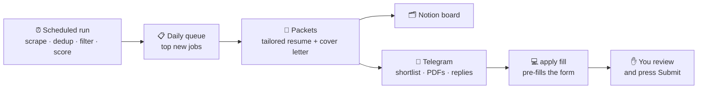
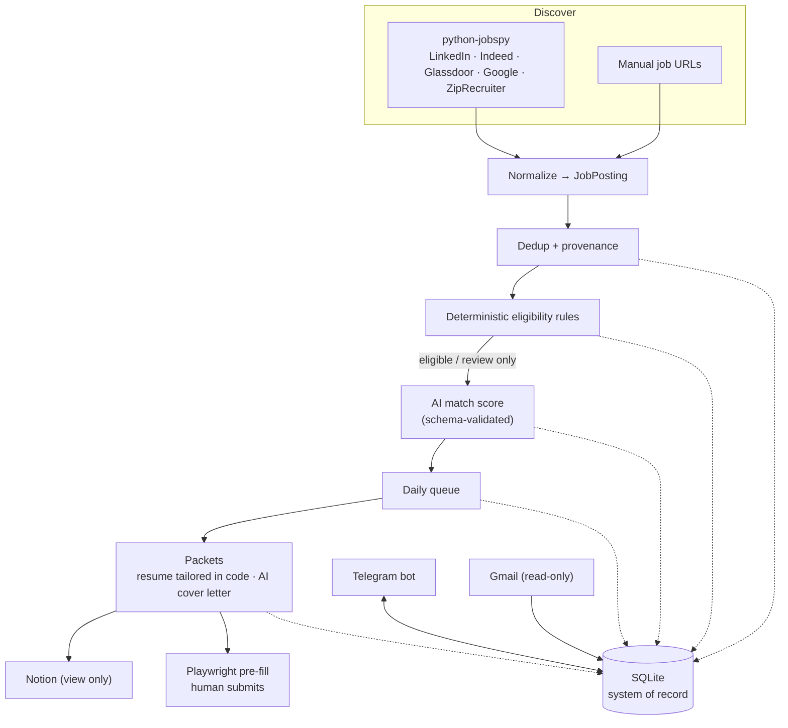

<div align="center">

# Applywise

**Your job search on autopilot, with your hand on the Submit button.**

A deterministic Python pipeline that finds, filters and prepares job applications, uses AI only where judgment is
needed, and runs from your phone.

[](https://github.com/Rahhhdayz/Applywise/actions/workflows/ci.yml)

[](LICENSE)
[](https://github.com/astral-sh/ruff)


</div>

---

## Why

Job hunting turns into a second job. You check five boards, read the same opening three times, rewrite a resume,
draft a cover letter, and type your education into another nine-step application form. Then you scan your inbox
for recruiter replies.

Applywise takes over the repetitive parts:

- **📱 Run it from your phone.** A Telegram bot understands plain English. You can ask for today's shortlist, send
  a job link and get a tailored packet back, check recruiter replies, start the daily run or mark a job applied.
- **📝 Stop retyping applications.** One command opens the application in a browser and fills it step by step. It
  handles sign-in, emailed security codes, resume upload and drafted answers, and an AI reviewer checks every step.
- **✋ You still decide.** Applywise never presses Submit. You review each page and send it yourself.

> The Python package and CLI command are named `jobagent`, for example `uv run jobagent run cycle`.

## How a day looks



1. **Morning.** The scheduled run scrapes, deduplicates, filters and ranks new jobs, then builds packets for the
   best ones. Telegram tells you when it's done.
2. **On your phone.** Ask "what's in today's queue?", send any job link you found yourself, and get the resume and
   cover-letter PDFs back in the chat.
3. **At your laptop.** `jobagent apply fill --job-id N` opens the form and fills it. If a CAPTCHA or sign-in step
   needs you, your phone buzzes.
4. **You submit.** Then mark the job applied from Telegram, and Notion updates.
5. **Replies.** Read-only Gmail tracking matches recruiter emails to applications and proposes status changes for
   you to approve with one tap.

## Architecture



- **SQLite is the source of truth.** Notion is only the UI, and JobAgent never reads Notion to decide its own
  state.
- **Python owns the pipeline.** Ingestion, normalization, dedup, filtering, queueing, files, sync and scheduling
  are all deterministic code.
- **AI has narrow jobs.** Match scoring uses the Codex CLI. Cover letters, outreach and follow-up drafts, form
  review, free-text answers, inbox fallback and bot intent routing use the Claude CLI. Every call runs in a
  restricted, tool-less mode with a JSON schema, and the output is validated before anything acts on it.

## Features

| Area | What it does | Why it helps |
|---|---|---|
| **Discovery** | Scrapes 5 boards through python-jobspy using search profiles, and imports any job URL (JSON-LD, Greenhouse and Oracle APIs) | One place instead of five tabs |
| **Dedup** | Normalizes company, title and location, merges cross-source copies and keeps provenance | Each opening shows up once |
| **Eligibility** | Deterministic rules for seniority, years, clearance, work authorization and employment type, before any AI | No reading, or paying a model for, jobs you can't apply to |
| **Scoring** | AI match score with a strict schema that cites evidence IDs, cached and capped per run | The best fits rise to the top |
| **Daily queue** | The top 15–20 *new* jobs a day (configurable), with closed LinkedIn postings dropped | A clear to-do list each morning |
| **Resume** | Copies your Word resume and appends only documented skills the posting asks for. It must stay one page. No AI. | Tailored without inventing anything |
| **Cover letters** | AI writes the body from your truth files and must cite real evidence IDs. It is validated for length and page fit. | A good first draft in minutes |
| **Outreach and follow-ups** | Finds a contact and drafts a short email and follow-ups. Drafts only, never sent. | Networking without a blank page |
| **Notion** | Pushes packets to a board and pulls status edits back, forward only | Your whole pipeline on one screen |
| **Telegram bot** | Slash commands plus plain English (Codex router, Haiku fallback), read-only job search over SQLite, `/fill` to start an unattended draft; scoped to one chat ID, with a confirm tap for anything that changes state | Run the search from your phone |
| **Gmail tracking** | Read-only IMAP. Rules classify replies (interview, rejection, offer and so on), with an AI fallback only when needed. Changes are proposed, then approved. | Never miss a recruiter reply |
| **Form pre-fill** | Links are resolved to the real ATS form first. Playwright fills Workday, Greenhouse, Lever, Ashby, iCIMS, SuccessFactors and more: sign-in, emailed codes, uploads, drafted answers, per-step AI review, practice mode | Applications in minutes, not an hour |
| **Scheduling** | launchd (macOS) or systemd units (Linux VPS), plus Telegram notifications and a daily digest | It runs while you sleep |

## Safety and integrity

- **Job text is untrusted.** Descriptions, web pages and emails reach AI only as delimited, labelled data. Calls run
  with `--restricted`, no tools and a throwaway working directory.
- **AI output is validated.** Pydantic schemas plus allow-lists (evidence IDs, fixed bot actions, real form options)
  are checked before any code acts on a result.
- **No invented experience.** Resume edits are deterministic and limited to skills you've documented. Generated
  text must cite real evidence IDs, and unknown IDs are rejected.
- **Submit is always human.** Fills never click Submit. Practice mode may click only Next, Continue, or Save and
  Continue. Any submit-like click raises `SubmitBlocked`, and tests record every click.
- **Secrets stay local.** They live only in `.env` (gitignored). Snapshots redact passwords and codes, the Workday
  password never reaches AI, Gmail is read-only (EXAMINE and BODY.PEEK only), and the bot token is kept out of logs.
- **SSRF guard on URL intake.** Only http(s) is accepted, private and loopback addresses are rejected after DNS
  resolution, and redirects and response size are capped.

See [SECURITY.md](SECURITY.md) for how to report a vulnerability.

## Quickstart

Requirements: Python 3.12 and [uv](https://docs.astral.sh/uv/). Optional: the Claude Code and Codex CLIs for the AI
steps, Microsoft Word (macOS) or LibreOffice for PDF export, and Notion, Telegram or Gmail credentials.

```sh
git clone https://github.com/Rahhhdayz/Applywise.git && cd Applywise
uv sync
uv run playwright install chromium        # only needed for apply fill
cp .env.example .env                      # fill in only the integrations you use
uv run jobagent setup && uv run jobagent init-db
uv run jobagent doctor --offline          # shows what is configured
```

Next, describe the candidate. Copy each `candidate/*.example.yaml` to its real name (`profile.yaml`,
`experience.yaml`, `skills.yaml`, `preferences.yaml`, `application.yaml`) and fill in your own facts. The real
files are gitignored.

```sh
uv run jobagent candidate validate
uv run jobagent run cycle --dry-run       # scrape + eligibility only: no AI, no Notion
uv run jobagent run cycle                 # the full daily pipeline
uv run jobagent bot                       # the Telegram bot
```

## Configuration

- **Secrets and integration switches** are environment variables listed in [`.env.example`](.env.example). An
  empty value disables that integration, and shell variables override `.env`.
- **Behavior** (scrape limits, queue size, per-run AI caps) lives in `config/settings.yaml`. Search profiles live
  in `config/search_profiles.yaml`. Each falls back to its `.example` file.

<details>
<summary><b>CLI reference</b></summary>

Every command accepts `--database PATH` before the subcommand. Run `uv run jobagent <command> --help` for options.

| Command | Purpose |
|---|---|
| `setup`, `init-db`, `doctor [--offline]` | Local folders, SQLite schema, prerequisite checks |
| `candidate validate` | Validate candidate truth files |
| `scrape profiles` / `scrape run --profile NAME \| --all` | List search profiles / scrape with python-jobspy |
| `add-url URL` | Import one public job URL |
| `list-jobs`, `jobs explain` | Inspect stored jobs and why each was filtered, scored or queued |
| `eligibility run [--job-id N]` | Deterministic eligibility rules |
| `evaluate --eligible [--limit N] [--dry-run]` | AI match scoring (cached) |
| `queue build` / `queue show` | Build or show the daily queue |
| `prepare --queue \| --job-id N` | Build packets (resume + cover letter); never submits |
| `notion setup \| sync \| pull` | Create Notion properties, push packets, pull status edits |
| `run cycle [--dry-run]` | The whole daily pipeline |
| `apply fill --job-id N [--practice]` | Pre-fill an application form for human review |
| `apply url URL` | Import a link, find its real form, prepare, sync and pre-fill |
| `apply train`, `review`, `review-prompt`, `findings`, `fixture`, `streak`, `track` | Training and review tooling for pre-fill |
| `inbox check [--dry-run]`, `inbox review`, `inbox adopt`, `inbox filter` | Read-only Gmail reply tracking |
| `status set N STATE`, `stats summary` | Lifecycle status and funnel stats |
| `followup list \| draft \| sent`, `outcome sweep` | Follow-up drafts (never sent), close quiet applications |
| `outreach --job-id N \| --queue` | Find a contact and draft an email (never sent) |
| `notify`, `digest send` | Telegram notifications and daily digest |
| `bot` | Run the Telegram bot (long polling): chat, read-only job search, `/fill` |
| `schedule generate \| status \| bot [--install]` | Render or install macOS launchd schedules |
| `add-demo-job` | Insert a fixed demo job (try it twice to see dedup) |

</details>

## Testing

```sh
uv run ruff check .
uv run pytest -q
```

The 447 tests cover normalization, dedup, eligibility, persistence, source adapters, scoring-schema validation,
the Notion, Telegram and Gmail adapters (all mocked), the form filler on HTML fixtures in headless Chromium,
prompt-injection fixtures, submit blocking and secret redaction. Tests never read real candidate data. CI runs
the same checks on every push.

## Limitations

- This is a personal tool, tuned for macOS (launchd, and Word for PDF export). Linux works with LibreOffice, but
  layout can differ slightly.
- Job boards may rate-limit or block scraping, and some consider it a terms-of-service violation. Glassdoor and
  ZipRecruiter often return nothing. No proxies or logins are used.
- Pre-fill handles native form controls. Custom widgets, CAPTCHAs and LinkedIn or Indeed Easy Apply are left to
  you, and employer-specific Workday tenants vary.
- The SSRF guard is basic: DNS rebinding is not fully prevented. Outreach email addresses are pattern guesses and
  may bounce.

## Unattended draft from Telegram

`/fill <id or job URL>` (after a confirm tap) runs `apply fill --job-id <id> --unattended` in the background. It is
practice mode run to the final step: it clicks only Next, Continue or Save and Continue, then one exact
"Save for Later" on the last step, and never Submit. On Workday it confirms the saved draft on the candidate home
page and sends you the link and what to review; on single-page forms the filled form stays open for you. You still
press Submit yourself.

## Roadmap

- Resolve more applicant-tracking systems and short links automatically.
- Add DNS-pinned fetching for stronger SSRF protection.
- Improve Linux PDF layout parity with Word.

## License

[MIT](LICENSE) © 2026 Rahul Sharma
