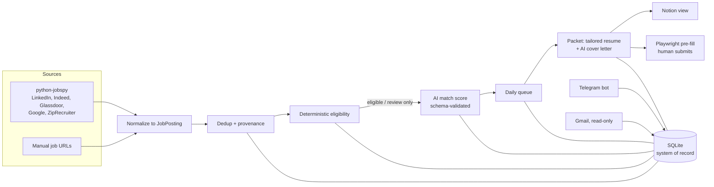

# Applywise

**A deterministic Python job-search pipeline with narrowly scoped AI: it finds, filters and prepares
applications, and you always press Submit yourself.**

The Python package and CLI command are named `jobagent` (for example, `uv run jobagent run cycle`).

## Why it exists

Applying well is slow. Most of that time goes to the same tasks: reading the same opening on four boards,
dropping roles that need a clearance or ten years of experience, adjusting a resume, writing a cover letter, and
retyping the same contact details into every applicant tracking system. Applywise automates that repetitive work
while staying safe:

- Python does every deterministic step, so the result is reproducible and testable.
- AI is used only where semantic judgment is needed, and its output is validated before anything acts on it.
- Job descriptions, web pages and emails are treated as untrusted data, never as instructions.
- AI never invents experience. Every claim it makes must trace back to the candidate's own truth files.
- Nothing is submitted for you. The final click always stays with a human.

## Architecture



- **SQLite is the system of record.** Every job, discovery, eligibility decision, AI assessment, queue entry, packet,
  status change and workflow run is stored there.
- **Notion is only the UI.** Applywise pushes rows to Notion and pulls back status edits that only move an
  application forward. It never reads Notion to decide its own state.
- **AI sits behind small interfaces.** Each AI step is one restricted CLI call (`claude -p --restricted` or
  `codex exec`) with no tools, a throwaway working directory and a JSON schema. Pydantic validates the result.
- **Each source is an adapter.** Every source outputs the canonical `JobPosting` model, and the jobspy DataFrame
  never leaves `jobagent/scrape/jobspy_source.py`.

## Features

**Discovery and intake**
- Scrapes five boards through python-jobspy using configurable search profiles (keywords × locations,
  freshness window, per-site limits, delay between queries). When a query is blocked, the block is recorded and the
  run moves on to the next query.
- `add-url` imports a single public job URL. It reads schema.org `JobPosting` JSON-LD (root, array and `@graph`),
  then page metadata, then a conservative fallback that uses the visible text. Greenhouse and Oracle Cloud postings
  are read through their structured APIs.
- Intake has basic SSRF protection. It rejects loopback, private and link-local addresses after DNS resolution,
  limits redirects and caps response size. Scripts and styles are stripped from descriptions, and only plain text
  is stored.
- The link resolver unwraps redirect links, maps careers-page links to their Greenhouse, Ashby or Lever form, and
  searches the company's public boards for the exact title.

**Normalization and deduplication**
- Company, title and location are normalized deterministically, and every timestamp is converted to UTC.
- A canonical dedup key and exact source identity or canonical-URL matching merge the same opening into one job. A
  `job_discoveries` provenance table records every source that found it.
- At queue time, one opening means one company and one title. This collapses LinkedIn's per-city copies and the
  matching ATS link. Dedup always runs before any paid AI call.

**Filtering and scoring**
- Eligibility rules are deterministic and explainable: employment-type conflicts, blocked seniority terms,
  mandatory years of experience, required clearance, work-authorization conflicts and source activity. Ambiguous
  jobs become `review` rather than being rejected silently.
- Only `eligible` and `review` jobs reach AI match scoring. The scorer has to return a strict schema (score,
  recommendation, strengths, gaps) that cites only real candidate evidence IDs. Results are cached by a fingerprint
  of the inputs, and the number of calls per run is capped.
- The daily queue takes only new jobs, at a configurable size. Right before a LinkedIn job is queued, its page is
  checked to make sure it is still open.

**Application packets**
- **Resume tailoring is deterministic (no AI).** Applywise copies your own Word resume and only appends
  job-description keywords to the skills lines. A keyword is added only if it is a skill in your truth files,
  appears in the posting and is not already listed. The resume must stay one page, so keywords are removed until the
  exported PDF fits.
- **Cover letters** come from Claude, which writes only the body and may use only facts from the candidate truth
  files. The posting is passed in as untrusted data. Python rejects any letter that cites unknown evidence IDs,
  falls outside 200-370 words, admits shortcomings or spills onto a second page.
- PDF export uses Microsoft Word on macOS and headless LibreOffice on Linux.
- Outreach emails and follow-up drafts follow the same rules (truth-only facts, validated). They are saved as
  drafts and never sent.

**Workflow surfaces**
- **Notion sync:** packets become database rows. `notion pull` copies status changes back into SQLite, moving an
  application forward only.
- **Telegram bot:** you can send a job link to import it and build its packet, fetch packet PDFs, mark jobs applied,
  start the daily cycle, check progress and read the queue. Plain English works through an AI intent router that
  has to choose from a fixed list of actions. Anything that changes state needs a confirm tap. Only one configured
  chat ID is served, and message text never reaches a shell.
- **Gmail response tracking:** IMAP access is strictly read-only (EXAMINE and BODY.PEEK only, enforced in code).
  Fixed rules match employer replies to applications and classify them (rejection, interview, offer and so on). An
  AI fallback handles only the emails the rules cannot classify. Statuses only move forward. By default the cycle
  only proposes changes, and they wait for your approval.

**Human-reviewed form pre-fill** (`apply fill`, Playwright)
- Fills native form controls on Greenhouse, Lever, Ashby, Workday, iCIMS, SuccessFactors, Eightfold, Oracle,
  JazzHR, Rippling, Workable and others from your application profile, and uploads the tailored resume.
- Multi-step wizards are filled one step at a time. You review each step and click Continue yourself. Applywise
  fills only empty fields, so anything you typed is kept.
- **The submit block is in code.** Practice mode (`--practice` / `apply train`) may click only Next, Continue, or
  Save and Continue. Any click on a submit-like control raises `SubmitBlocked`, and tests record every click to
  prove it.
- **AI reviewer:** a restricted Claude reviews each settled step. The page snapshot goes in an escaped
  `UNTRUSTED_PAGE_DATA` block. A finding must name a real field, and any suggested value must be one of your own
  values or a matching field option. Otherwise it is downgraded to "missing truth" with no value.
- **AI free-text drafts** use only truth-file facts. They are validated to 60-150 words of plain text, typed only
  into empty fields and marked `ai_draft` for your review.
- Snapshots redact passwords, codes and token URLs at capture time. The Workday password is never sent to AI. Email
  verification links are followed only on Workday domains, and security codes are typed but never logged.
- Every reviewer finding can be turned into a regression fixture (`apply fixture`). `tests/test_fill_findings.py`
  replays all of them.

**Operations**
- `run cycle` runs the whole pipeline in order: Notion pull → inbox → scrape → eligibility → score → queue →
  packets → outreach drafts → Notion. A step that fails is recorded, and the later steps still run.
- Scheduling uses launchd (macOS, `schedule generate` / `schedule bot --install`) or the systemd units in `deploy/`
  (Linux VPS; see `vps.md`).

## Safety design

| Risk | Control |
|---|---|
| Prompt injection in job descriptions, pages or emails | External text is always delimited, labelled untrusted data. AI calls run with `--restricted`, no tools, a throwaway working directory and a JSON schema. |
| AI output acting on real systems | Every AI output is validated by Pydantic plus allow-lists (evidence IDs, fixed bot actions, field options) before Python acts on it. |
| Invented experience | Resume edits are deterministic and evidence-gated. Generated text must cite real evidence IDs, and unknown IDs are rejected. |
| Accidental submission | No submit path exists. Practice-mode navigation goes through `guard_click`, which raises `SubmitBlocked`. |
| Unreviewed bulk changes | Bot and automation paths that change state run as a dry run first and apply only after an explicit confirm. |
| Credential leaks | Secrets live only in `.env` (gitignored). Snapshots redact passwords and codes. Gmail is read-only and the bot token is kept out of logs. |
| SSRF via job URLs | Only http(s) is accepted, private and loopback addresses are rejected after DNS resolution, and redirects and response size are capped. |

## Quickstart

Requirements: Python 3.12 (python-jobspy pins numpy 1.26), [uv](https://docs.astral.sh/uv/). Optional: the
Claude Code CLI (writing and review), the Codex CLI (scoring), Microsoft Word or LibreOffice (PDF export), plus
Notion, Telegram and Gmail credentials.

```sh
uv sync
uv run playwright install chromium     # only needed for apply fill
cp .env.example .env                   # fill in only the integrations you use
uv run jobagent setup
uv run jobagent init-db
uv run jobagent doctor --offline       # shows what is configured
```

Candidate truth lives in `candidate/`. The checked-in `*.example.yaml` files are synthetic templates. Copy each
one to its real name (`profile.yaml`, `experience.yaml`, `skills.yaml`, `preferences.yaml`, `application.yaml`) and
replace the contents with your own facts. Real files are gitignored. Do the same for
`config/search_profiles.example.yaml` and `config/settings.example.yaml` if you want to override them. Then:

```sh
uv run jobagent candidate validate
uv run jobagent run cycle --dry-run    # scrape + eligibility only: no AI, no Notion
uv run jobagent run cycle              # the full daily pipeline
```

## CLI reference

Every command accepts `--database PATH` before the subcommand. Run `uv run jobagent <command> --help` for options.

| Command | Purpose |
|---|---|
| `setup`, `init-db`, `doctor [--offline]` | Local folders, SQLite schema, prerequisite checks |
| `candidate validate` | Validate candidate truth files |
| `scrape profiles` / `scrape run --profile NAME \| --all` | List search profiles / scrape with python-jobspy |
| `add-url URL` | Import one public job URL |
| `list-jobs`, `jobs explain` | Inspect stored jobs and why each was filtered, scored or queued |
| `eligibility run [--job-id N]` | Deterministic eligibility rules |
| `evaluate --eligible [--limit N] [--dry-run]` | AI match scoring (cached) |
| `queue build` / `queue show` | Build or show the daily queue |
| `prepare --queue \| --job-id N` | Build packets (resume + cover letter); never submits |
| `notion setup \| sync \| pull` | Create Notion properties, push packets, pull status edits |
| `run cycle [--dry-run]` | The whole daily pipeline |
| `apply fill --job-id N [--practice]` | Pre-fill an application form for human review |
| `apply url URL` | Import a link, find its real form, prepare, sync and pre-fill |
| `apply train`, `review`, `review-prompt`, `findings`, `fixture`, `streak`, `track` | Training and review tooling for pre-fill |
| `inbox check [--dry-run]`, `inbox review`, `inbox adopt`, `inbox filter` | Read-only Gmail reply tracking |
| `status set N STATE`, `stats summary` | Lifecycle status and funnel stats |
| `followup list \| draft \| sent`, `outcome sweep` | Follow-up drafts (never sent), close quiet applications |
| `outreach --job-id N \| --queue` | Find a contact and draft an email (never sent) |
| `notify`, `digest send` | Telegram notifications and daily digest |
| `bot` | Run the Telegram bot (long polling) |
| `schedule generate \| status \| bot [--install]` | Render or install macOS launchd schedules |
| `add-demo-job` | Insert a fixed demo job (try it twice to see dedup) |

## Configuration

All secrets and integration switches are environment variables. `.env.example` lists each one with an empty
value, and an empty variable disables that integration. `.env` is loaded automatically and is gitignored. Shell
variables take precedence over `.env`. Non-secret behavior (scrape limits, queue size, per-run AI caps) lives in
`config/settings.yaml`. Search profiles live in `config/search_profiles.yaml`, and each falls back to its
`.example` file.

## Testing

```sh
uv run ruff check .
uv run pytest -q
```

The suite (447 tests at the time of writing) covers normalization, dedup, eligibility, persistence, the source
adapters, scoring-schema validation, the Notion, Telegram and Gmail adapters (all mocked), the form filler on HTML
fixtures, prompt-injection fixtures, submit blocking and secret redaction. Tests never read real candidate data and
load the example files explicitly.

## Limitations

- This is a personal tool built around one candidate's workflow. It runs best on macOS: launchd scheduling and
  Word for PDF export. Linux works with LibreOffice, but the layout can differ slightly.
- Job boards may rate-limit or block scraping and may consider it a terms-of-service violation. Glassdoor and
  ZipRecruiter often return nothing. No proxies or logins are used.
- Pre-fill handles native form controls only. Custom JavaScript widgets, CAPTCHAs and LinkedIn or Indeed Easy Apply
  are left to you. Employer-specific Workday tenants vary, so expect some manual corrections.
- SSRF protection is basic: DNS rebinding is not fully prevented.
- AI steps depend on the Claude Code and Codex CLIs and the subscriptions or API keys behind them.
- Outreach emails are guesses based on company address patterns and may bounce.

## License

[MIT](LICENSE)
